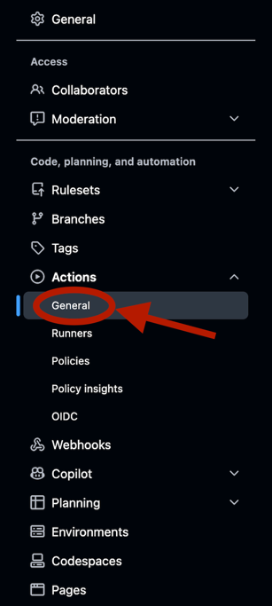
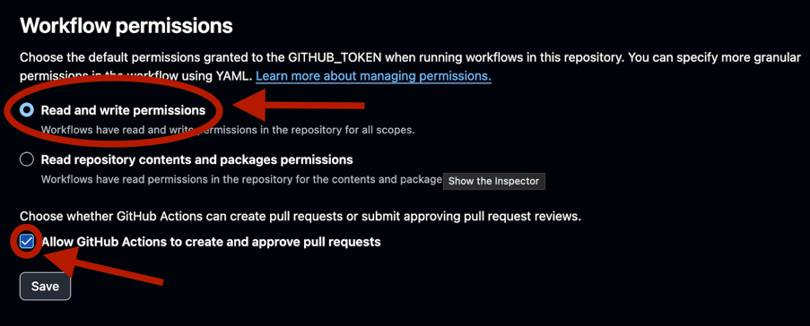
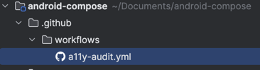

# Mobile A11y Guardian

Configurable GitHub Action to automatically run accessibility audits on mobile web applications and post findings as comments on pull requests.

Requires a GitHub repository with a pull request workflow and a mobile web application that can be accessed via a URL.


## Follow the steps below to set up the action in your repository.

# Step 1: 

Give permissions to the workflow to read and write to the repository following the steps on images below:
    
    Go to settings in your repository


    On the sidebar menu on your left, click on Actions > General and scroll down to the "Workflow permissions" section.



    Select the option "Read and write permissions" and check the box "Allow GitHub Actions to create and approve pull requests".



# Step 2:

    Create a new workflow file in your repository's `.github/workflows` directory, for example, `a11y-audit.yml`.



# Step 3:

    Copy the following code into your workflow file, replacing `your-organization` with your GitHub organization or username, and `your-repo` with the name of your repository.


```yaml
name: Accessibility CI

on:
  pull_request:
    types: [opened, synchronize, reopened, ready_for_review]
    paths:
      - '**.kt'

jobs:
  run-audit:
    uses: your-organization/mobile-a11y-guardian/.github/workflows/reusable_audit.yml@main
    secrets: inherit
```


you can also replace default inputs with your own values:

    Available inputs:
        provider: The provider to use for the accessibility audit. Default is 'grok'. available options are 'grok' and 'gemini'.
        model: The model to use for the accessibility audit. Default is 'qwen/qwen3.8-27b'.

Example:
```yaml
jobs:
  run-audit:
    uses: your-organization/mobile-a11y-guardian/.github/workflows/reusable_audit.yml@main
    with:
      provider: 'gemini'
      model: 'gemini-2.5-flash'
    secrets: inherit
    
```